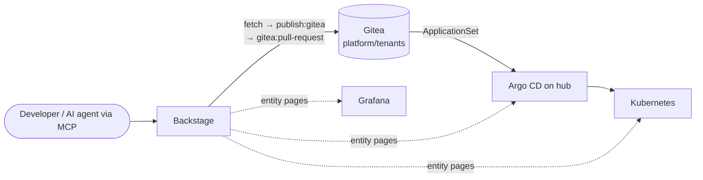

# skylab-backstage

Backstage front door for the **Skylab** platform: catalog, golden-path templates, a custom Gitea scaffolder action, and MCP actions for AI clients.

Published as `ghcr.io/skylarhoughtongithub/skylab-backstage:v<version>` with SBOM + cosign signatures. The chart that runs it in-cluster lives in [skylab-gitops](https://github.com/SkylarHoughtonGithub/skylab-gitops) at wave 6.

## Architecture



Scaffolder templates write to Gitea as a pull request. The gitops ApplicationSet watches `platform/tenants` and Argo CD delivers to the cluster. Backstage **never writes to clusters directly** — entity pages surface what Argo, Kubernetes, and Grafana already know.

## What's inside

### Catalog — discovery, not manual registration

A CI job regenerates a root `catalog-info.yaml` from the `templates/` tree so adding a template means adding a folder. Gitea entity discovery pulls per-repo `catalog-info.yaml` from the `platform` Gitea org on a 10-minute schedule. The bootstrapped catalog ships four Domains, five Systems covering the sibling repos, Group `platform`, and User `skylar`.

### Scaffolder — two golden paths today

| Template | What it produces |
| --- | --- |
| **Go service** | Go skeleton (OTel-wired `main.go`, distroless Dockerfile, Gitea Actions CI with Trivy + cosign + SBOM, TechDocs), catalog entry, and a KubeVela Application opened as a PR against `platform/tenants` |
| **Postgres database for a service** | Sibling KubeVela Application using the Skylab `postgres` ComponentDefinition; the resulting `db-url` Secret is picked up via `envFrom` on the target service |

Workflow steps: `fetch:template` → `publish:gitea` (upstream module) → `catalog:register` → `fetch:template` → `gitea:pull-request` (custom action, below).

### Custom plugins

- **`scaffolder-backend-module-gitea-pr/`** — exposes the `gitea:pull-request` scaffolder action (clone → new branch → copy workspace → commit → push → open PR). Credentials via `integrations.gitea[].password` (Backstage's `GiteaIntegrationConfig` has no `token` field, so the Gitea PAT goes in `password`).
- **`skylab-actions/`** — a `backend-plugin-module` that registers MCP actions on Backstage's `actionsRegistryServiceRef`. Two ship today:
  - `platform-ping` — read-only connectivity probe
  - `argocd-recent-failures` — lists Argo CD Applications whose last sync op finished in `Failed`/`Error` within a look-back window, across one or all configured instances. Takes `instance?` / `withinHours?` (1–168, default 24) / `limit?` (1–100, default 20); returns failures newest-first with phase, message, sync+health status, and revision. Per-instance query errors are surfaced as `warnings` so one dead instance doesn't poison the response.

### Entity pages

Kubernetes, Argo CD, and Grafana plugins are wired so entity pages surface the cluster, delivery, and dashboard state for every Component. The Kubernetes plugin registers KubeVela (Applications, ComponentDefinitions, TraitDefinitions) and Crossplane (Providers, Configurations, XRDs) as custom resources so platform CRs render next to standard workloads.

### Auth

Generic OIDC with Gitea as IdP; `preferredUsernameMatchingUserEntityName` resolver aligns Gitea usernames to catalog User entities. The sign-in page lists `guest` + `oidc`.

## Repo layout

```
skylab-backstage/
├── app/
│   ├── packages/
│   │   ├── app/        # Backstage frontend
│   │   └── backend/    # Backstage backend
│   ├── plugins/
│   │   ├── scaffolder-backend-module-gitea-pr/
│   │   └── skylab-actions/
│   ├── catalog/        # org.yaml + Systems + Domains
│   ├── templates/
│   │   ├── go-service/
│   │   └── database/
│   ├── app-config.yaml
│   └── catalog-info.yaml  # root Location, regenerated by CI
├── infra-templates/    # legacy (migration source material)
├── workload-templates/ # legacy (migration source material)
├── tetris-react/       # legacy demo app; slated for replacement
├── release-please-config.json
└── plan.md
```

## Local dev

Requires **Node 22** (Node 26 is unsupported by Backstage's current deps) and Yarn Berry 4.

```sh
cd app/
yarn install
yarn start    # Backstage dev server at http://localhost:3000
```

## CI and release

| Workflow | What it does |
| --- | --- |
| `.github/workflows/catalog.yml` | Entity validator via Roadie's action in a per-file matrix; fails if `catalog-info.yaml` or any template entity is invalid |
| `.github/workflows/image.yml` | Builds the image, Trivy-scans (CRITICAL only — HIGHs are upstream Backstage transitives tracked via Dependabot), and on tag publishes signed images to `ghcr.io/skylarhoughtongithub/skylab-backstage` with SBOM + provenance |
| `.github/workflows/release-please.yaml` | Conventional-Commits-driven release PR; merging it cuts a tag that `image.yml` reacts to |

Image tag bumps in [skylab-gitops](https://github.com/SkylarHoughtonGithub/skylab-gitops) `charts/backstage/` are auto-opened by Renovate.

## Cross-repo map

| Repo | Role |
| --- | --- |
| [skylab-gitops](https://github.com/SkylarHoughtonGithub/skylab-gitops) | Wraps the image at wave 6; `charts/kubevela-defs` provides the component vocabulary templates instantiate |
| [skylab-terraform](https://github.com/SkylarHoughtonGithub/skylab-terraform) | Hosts the TechDocs bucket, Gitea OIDC secrets, and step-ca trust bundle |
| [skylab-crossplane](https://github.com/SkylarHoughtonGithub/skylab-crossplane) | `KubernetesCluster`, `Postgres`, `Bucket` XRDs that the cluster and database templates reference |

## Where to go next

- **[`plan.md`](plan.md)** — status, remaining MCP actions (SLO burn rate, KubeVela workflow status, environment requests), roadmap.
- **[`AGENTS.md`](AGENTS.md)** — engineering context for coding agents.
- **[`app/templates/`](app/templates/)** — the golden paths themselves.
